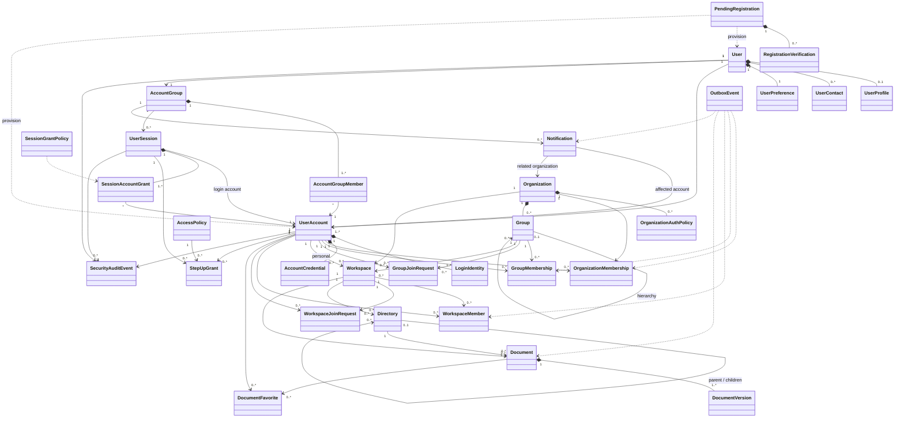

# Drive Platform — Project Specification

## 1. Purpose

Build a production-oriented Drive-like platform using Java/Spring Boot microservices.

The differentiating feature is contextual and inherited access. Users can have independent Personal, Company, University, or other accounts that are soft-linked into one unified drive experience. Organization and group membership can automatically grant access to workspaces and their directory/document trees.

This document is the architectural source of truth for implementation. If implementation requirements conflict with this document, identify the conflict before changing domain semantics.

---

## 2. Technology Baseline

- Java 25
- Spring Boot 4.1.1
- Maven 3.9.16
- Spring Security
- Spring Data JPA
- MySQL
- Flyway
- Redis
- Caffeine
- Apache Kafka
- Elasticsearch
- S3-compatible object storage
- Testcontainers
- Prometheus
- OpenTelemetry
- Centralized structured logging
- Angular frontend
- API Gateway / Load Balancer

### System-of-record rules

- MySQL is the durable source of truth for transactional domain state.
- S3 is the durable source of truth for document binary content.
- Redis and Caffeine are disposable caches/projections.
- Elasticsearch is a reconstructible search projection, never the source of truth.
- Kafka transports asynchronous domain/security events.
- Use the transactional outbox pattern for DB-to-Kafka propagation.
- Kafka consumers must be idempotent.
- Services must never access another service's database directly.

---

## 3. Service Boundaries

### IAM / Auth Service

Owns:

- PendingRegistration
- RegistrationVerification
- User
- UserProfile
- UserContact
- UserPreference
- UserAccount
- LoginIdentity
- AccountCredential
- AccountGroup
- AccountGroupMember
- UserSession
- SessionAccountGrant
- SessionGrantPolicy
- SecurityAuditEvent
- Organization
- OrganizationAuthPolicy
- OrganizationMembership
- Group
- GroupMembership
- GroupJoinRequest
- IAM authorization projection/cache
- IAM outbox events

### Document Service

Owns:

- Workspace
- WorkspaceMember
- WorkspaceJoinRequest
- Directory
- Document
- DocumentVersion
- DocumentFavorite
- Resource AccessPolicy / StepUpGrant when resource-specific
- Document-domain outbox events

### Notification Service

Owns:

- Notification
- Notification delivery state
- Notification outbox events as needed

Cross-service identifiers such as `accountId`, `organizationId`, or `createdBy` are UUID values. Do not create database foreign keys across service databases.

---

## 4. Identity Model

### 4.1 User

`User` represents the human/person and global profile.

Suggested fields:

```text
User
- UUID id
- String displayName
- UserStatus status
- Instant lastLoginAt
- Instant createdAt
- Instant updatedAt
```

`User` must not be used as an authorization shortcut. Authorization occurs through a `UserAccount` and current memberships/session grants.

### 4.2 UserProfile

```text
UserProfile
- UUID userId
- String firstName
- String middleName
- String lastName
- LocalDate dateOfBirth (optional; only collect if required)
- String profileImageKey
- String locale
- String timeZone
- Instant updatedAt
```

### 4.3 UserContact

Supports multiple contact methods.

```text
UserContact
- UUID id
- UUID userId
- ContactType type
- String value
- boolean primary
- boolean verified
- Instant verifiedAt
- Instant createdAt
```

### 4.4 UserPreference

```text
UserPreference
- UUID userId
- UUID preferredAccountId
- Theme theme
- String locale
- String timeZone
- boolean emailNotifications
- boolean pushNotifications
- boolean securityNotifications
- Instant updatedAt
```

`preferredAccountId` is a navigation/default preference only. It must never bypass authentication.

---

## 5. Pending Registration

Incomplete registration must not create a real authorized User/UserAccount.

### PendingRegistration

```text
PendingRegistration
- UUID id
- RegistrationType registrationType
- String firstName
- String middleName
- String lastName
- String displayName
- String identifier
- IdentityType identityType
- String passwordHash
- RegistrationStatus status
- UUID organizationId (nullable when applicable)
- UUID invitationId (nullable when applicable)
- Instant createdAt
- Instant expiresAt
- Instant verifiedAt
- Instant completedAt
```

Statuses:

```text
PENDING_VERIFICATION
VERIFIED
COMPLETED
EXPIRED
CANCELLED
```

### RegistrationVerification

```text
RegistrationVerification
- UUID id
- UUID pendingRegistrationId
- VerificationType verificationType
- String destination
- String codeHash
- String tokenHash
- VerificationStatus status
- int attemptCount
- Instant createdAt
- Instant expiresAt
- Instant verifiedAt
```

Statuses:

```text
PENDING
VERIFIED
EXPIRED
FAILED
REVOKED
```

Never store OTPs, verification tokens, PINs, or passwords in plaintext.

### Registration lifecycle

```text
Registration request
    ->
PendingRegistration(PENDING_VERIFICATION)
    ->
RegistrationVerification
    ->
VERIFIED
    ->
transactional provisioning
    ->
User / Profile / Contact
UserAccount / LoginIdentity
AccountGroup / AccountGroupMember
    ->
PendingRegistration(COMPLETED)
```

`VERIFIED` is intentionally distinct from `COMPLETED`, so provisioning can be retried without requiring identity verification again.

A pending registration cannot own documents, join normal groups, create normal authenticated sessions, or receive organization/workspace permissions.

---

## 6. UserAccount and Unified Drive

`UserAccount` is an independently authenticated account/security context.

Examples:

```text
User: John Smith

AccountGroup
├── Personal UserAccount
├── Acme UserAccount
└── University UserAccount
```

These are real independent accounts, not folders.

### UserAccount

```text
UserAccount
- UUID id
- UUID userId
- AccountType type
- String displayName
- AccountStatus status
- Instant createdAt
- Instant updatedAt
```

For pre-provisioned organization identities, do not force a `User` association until control/linking has been verified if the human identity is not yet known.

### LoginIdentity

Represents an identifier/login mechanism.

```text
LoginIdentity
- UUID id
- UUID accountId
- IdentityType type
- String identifier
- String passwordHash
- String externalSubject
- IdentityStatus status
- long credentialVersion
- Instant lastAuthenticatedAt
- Instant createdAt
- Instant updatedAt
```

### AccountCredential

Additional account-root unlock mechanisms.

```text
AccountCredential
- UUID id
- UUID accountId
- CredentialType type
- String credentialHash
- CredentialStatus status
- long version
- Instant createdAt
- Instant updatedAt
```

Potential credential types:

```text
PASSWORD
PIN
PASSKEY
TOTP
SSO
```

### AccountGroup

Soft-links independent accounts into the unified drive experience.

```text
AccountGroup
- UUID id
- UUID userId
- AccountGroupStatus status
- Instant createdAt
- Instant updatedAt
```

Do not use AccountGroup to grant organization permissions.

### AccountGroupMember

```text
AccountGroupMember
- UUID accountGroupId
- UUID accountId
- LinkStatus status
- LinkMethod linkMethod
- UUID linkedByAccountId
- Instant linkedAt
- Instant disconnectedAt
```

A UserAccount may belong to at most one AccountGroup.

Account linking requires proof/control and audit history. Linking accounts must never itself grant organization permissions.

---

## 7. Authentication and Sessions

### Core principle

JWT proves authenticated identity/session context. It must not contain the complete mutable permission graph.

Suggested access token claims:

```text
sub
sid
iss
aud
iat
exp
```

Use asymmetric signing and `kid`-based JWKS key rotation.

Every service validates JWTs locally:

- signature
- issuer
- audience
- expiration
- permitted algorithm
- required claims

Use HTTP 401 for missing/invalid/expired authentication and 403 for an authenticated principal lacking permission.

### UserSession

One login creates an umbrella session:

```text
UserSession
- UUID id
- UUID accountGroupId
- UUID loginAccountId
- SessionStatus status
- Instant authenticatedAt
- Instant lastActivityAt
- Instant expiresAt
- Instant revokedAt
```

### SessionAccountGrant

Represents an account currently unlocked within a session.

```text
SessionAccountGrant
- UUID id
- UUID sessionId
- UUID accountId
- GrantStatus status
- AuthenticationMethod authMethod
- long credentialVersion
- Instant authenticatedAt
- Instant lastActivityAt
- Instant idleExpiresAt
- Instant absoluteExpiresAt
- Instant revokedAt
- GrantRevocationReason revocationReason
```

The account whose credentials created the session is automatically granted:

```text
authMethod = LOGIN
```

It must not immediately require another PIN/password challenge.

Other linked accounts start locked and require a challenge.

Example:

```text
Login using University credentials

SESSION
├── Personal    LOCKED
├── Acme        LOCKED
└── University  UNLOCKED (LOGIN)
```

After Acme PIN verification:

```text
SESSION
├── Personal    LOCKED
├── Acme        UNLOCKED (PIN)
└── University  UNLOCKED (LOGIN)
```

Multiple account grants may remain active simultaneously. Do not model a single server-side global `activeAccountId`.

The requested resource/account root determines context.

### Grant validity

A grant is valid only when all relevant conditions remain valid:

```text
account is linked/available
AND SessionAccountGrant is ACTIVE and unexpired
AND underlying OrganizationMembership is ACTIVE when applicable
AND required Group/Workspace authorization is valid
AND optional StepUpGrant is valid when required
```

Expiration can be enforced lazily at authorization time. A cleanup worker may later mark/delete expired grants.

### SessionGrantPolicy

```text
SessionGrantPolicy
- UUID id
- PolicyScopeType scopeType
- UUID scopeId
- Duration idleTimeout
- Duration absoluteTimeout
- boolean allowMultiAccount
- boolean requireReauthentication
- long version
- Instant createdAt
- Instant updatedAt
```

Organization security policy may override user preference.

Possible grant revocation reasons:

```text
LOGOUT
IDLE_TIMEOUT
ABSOLUTE_TIMEOUT
MEMBERSHIP_REVOKED
ACCOUNT_DISABLED
CREDENTIAL_CHANGED
ADMIN_REVOKED
SECURITY_POLICY_CHANGED
SESSION_REVOKED
```

---

## 8. Preferred Account and Fallback

Preferred account is stored in `UserPreference.preferredAccountId`.

It affects navigation/default selection only.

It must never automatically unlock an account.

Fallback after account/organization revocation:

1. Use Personal if Personal remains available.
2. If Personal is unavailable and exactly one account remains, use that account.
3. If multiple non-personal accounts remain, show an account selector unless a future explicit ordering rule is defined.
4. If the fallback account lacks a valid SessionAccountGrant, require its authentication challenge before exposing data.

Revoking the account originally used for login does not necessarily terminate the entire AccountGroup session if another valid account remains usable. If no usable account remains, terminate the session.

---

## 9. Organizations

### Organization

```text
Organization
- UUID id
- String name
- String slug
- OrganizationType type
- OrganizationStatus status
- Instant createdAt
- Instant updatedAt
```

### OrganizationAuthPolicy

```text
OrganizationAuthPolicy
- UUID id
- UUID organizationId
- AuthMethod authMethod
- String emailDomain
- boolean enabled
- boolean allowPinUnlock
- boolean requireMfa
- Instant createdAt
- Instant updatedAt
```

### OrganizationMembership

```text
OrganizationMembership
- UUID id
- UUID organizationId
- UUID accountId
- OrganizationRole role
- MembershipStatus status
- String officialEmail
- String memberCode
- String externalIdentity
- long version
- Instant joinedAt
- Instant revokedAt
- UUID revokedBy
- Instant createdAt
- Instant updatedAt
```

Use generic `memberCode` rather than employee-specific naming.

Active organization membership is the top-level authorization kill switch for organization descendants.

Organization-specific fields such as department, student ID, employee/member code, official organization email, or organization role do not belong on `User`.

### Organization revocation

Revocation must:

```text
OrganizationMembership ACTIVE -> REVOKED
    ->
increment authorization version
    ->
write OutboxEvent in same transaction
    ->
invalidate/update IAM Redis projection
    ->
publish Kafka security event
    ->
downstream services invalidate Caffeine
    ->
revoke relevant SessionAccountGrant(s)
    ->
create durable notification
    ->
calculate safe fallback
```

After revocation, organization content must not leak through:

- root/account listing
- search
- recent items
- favorites
- suggestions
- notifications containing protected content
- autocomplete

Audit history may retain internal references.

---

## 10. Groups and Contextual Access

### Group

```text
Group
- UUID id
- UUID organizationId
- UUID parentGroupId
- String name
- GroupType type
- GroupStatus status
- Instant createdAt
- Instant updatedAt
```

Suggested group types:

```text
DEPARTMENT
COURSE
CLASS
TEAM
PROJECT
CUSTOM
```

### GroupMembership

```text
GroupMembership
- UUID id
- UUID groupId
- UUID accountId
- String role
- GroupMembershipType membershipType
- MembershipSource source
- String sourceReference
- MembershipStatus status
- Instant validFrom
- Instant validUntil
- long version
- Instant createdAt
- Instant updatedAt
```

Customizable roles should generally be data/string/table-driven rather than hard-coded enums.

Membership sources may include:

```text
ORGANIZATION_ASSIGNMENT
ADMIN_APPROVAL
COURSE_ENROLLMENT
INVITATION
DIRECTORY_SYNC
```

Do not allow a user to self-claim a sensitive department/course and automatically receive access.

### GroupJoinRequest

```text
GroupJoinRequest
- UUID id
- UUID groupId
- UUID accountId
- String requestedRole
- RequestStatus status
- String reason
- UUID reviewedBy
- Instant reviewedAt
- Instant createdAt
```

---

## 11. Workspace Authorization

### Workspace

```text
Workspace
- UUID id
- WorkspaceOwnerType ownerType
- UUID ownerId
- UUID organizationId
- UUID groupId
- String name
- String description
- WorkspaceAccessScope accessScope
- WorkspaceStatus status
- UUID createdBy
- Instant createdAt
- Instant updatedAt
```

Access scopes:

```text
OWNER
ORGANIZATION
GROUP
RESTRICTED
```

Semantics:

- OWNER: personal owner only.
- ORGANIZATION: any active member of the owning organization.
- GROUP: active organization member plus active owning-group membership.
- RESTRICTED: active organization member plus explicit WorkspaceMember.

Everything is private to the platform. The UI may call RESTRICTED a "Private Workspace."

### WorkspaceMember

```text
WorkspaceMember
- UUID id
- UUID workspaceId
- UUID accountId
- WorkspaceRole role
- MembershipStatus status
- UUID addedBy
- Instant createdAt
- Instant revokedAt
```

### WorkspaceJoinRequest

```text
WorkspaceJoinRequest
- UUID id
- UUID workspaceId
- UUID accountId
- RequestStatus status
- String message
- UUID reviewedBy
- Instant reviewedAt
- Instant createdAt
```

Group membership grants inherited access to GROUP workspaces.

Workspace membership grants explicit access to RESTRICTED workspaces.

Do not create per-user per-file ACL rows for inherited workspace access.

---

## 12. Directory Hierarchy

Use one self-referencing `Directory` entity. Do not create separate SubDirectory classes/tables.

```text
Directory
- UUID id
- UUID workspaceId
- UUID parentDirectoryId
- String name
- DirectoryType type
- DirectoryStatus status
- long directDirectoryCount
- long directDocumentCount
- long descendantDirectoryCount
- long descendantDocumentCount
- long descendantSizeBytes
- UUID createdBy
- Instant createdAt
- Instant updatedAt
```

Directory types:

```text
ROOT
NORMAL
```

Prefer one root per workspace. A virtual/lazy root is acceptable for empty accounts/workspaces if useful at scale.

Hierarchy:

```text
ROOT
├── Engineering
│   ├── Backend
│   │   └── API
│   └── Frontend
└── Finance
```

A subdirectory is simply a Directory whose `parentDirectoryId` points to another Directory.

Prevent cycles when moving directories. A directory cannot be moved under itself or any descendant.

### Directory counters

`directDirectoryCount`:
number of immediate child directories.

`directDocumentCount`:
number of immediate documents.

`descendantDirectoryCount`:
all nested directories below this directory, excluding itself.

`descendantDocumentCount`:
all documents in the complete subtree.

`descendantSizeBytes`:
total binary size represented by documents in the subtree according to the chosen product semantics.

Direct counters should be updated transactionally with direct metadata changes.

Deep descendant counters may be maintained asynchronously through Outbox -> Kafka if needed to avoid hot-row contention. Eventual consistency is acceptable for UI statistics; it is not acceptable for authorization decisions.

Do not use Elasticsearch as the authoritative directory/file counter.

### Core indexes

Design directory lookups around workspace locality:

```text
(workspace_id, parent_directory_id, status, name, id)
```

Use cursor/keyset pagination rather than deep OFFSET pagination.

---

## 13. Document Model

### Document

```text
Document
- UUID id
- UUID workspaceId
- UUID directoryId
- UUID currentVersionId
- String name
- String mimeType
- long sizeBytes
- DocumentStatus status
- UUID createdBy
- Instant createdAt
- Instant updatedAt
```

### DocumentVersion

```text
DocumentVersion
- UUID id
- UUID workspaceId
- UUID documentId
- long versionNumber
- String storageKey
- long sizeBytes
- String checksum
- String mimeType
- UUID uploadedBy
- Instant createdAt
```

Carrying `workspaceId` into high-volume child metadata may be useful as a denormalized locality/routing key.

Document binary content belongs in S3, not MySQL.

Prefer direct-to-S3 presigned upload flows:

```text
Client -> metadata/upload authorization -> presigned S3 upload
       -> finalize metadata
       -> outbox/Kafka
       -> async processing/indexing
```

### DocumentFavorite

```text
DocumentFavorite
- UUID accountId
- UUID documentId
- Instant createdAt
```

A favorite never grants access. If authorization is revoked, a favorite must not make the document visible.

---

## 14. Resource Step-Up Authentication

Step-up verification is an additional factor, not a permission grant.

### AccessPolicy

```text
AccessPolicy
- UUID id
- ProtectedResourceType resourceType
- UUID resourceId
- VerificationType verificationType
- String credentialHash
- long credentialVersion
- Duration grantDuration
- boolean enabled
- Instant createdAt
- Instant updatedAt
```

### StepUpGrant

```text
StepUpGrant
- UUID id
- UUID sessionId
- UUID accountId
- ProtectedResourceType resourceType
- UUID resourceId
- VerificationType verificationType
- long credentialVersion
- Instant verifiedAt
- Instant expiresAt
- Instant revokedAt
```

Authorization semantics:

```text
not authorized + knows step-up code -> DENY
authorized + step-up required + no valid grant -> STEP_UP_REQUIRED
authorized + valid step-up grant -> ALLOW
```

Bind step-up grants to a UserSession/account so they cannot transfer across sessions.

---

## 15. Notifications

```text
Notification
- UUID id
- UUID accountGroupId
- UUID affectedAccountId
- UUID organizationId
- NotificationType type
- NotificationSeverity severity
- String title
- String message
- Instant createdAt
- Instant readAt
```

Organization revocation should generate a durable notification without unnecessarily exposing sensitive administrative details.

---

## 16. Security Audit

```text
SecurityAuditEvent
- UUID id
- UUID userId
- UUID accountId
- UUID sessionId
- UUID organizationId
- SecurityEventType eventType
- String ipAddress
- String userAgent
- Instant occurredAt
```

Events should include at least:

```text
LOGIN_SUCCESS
LOGIN_FAILURE
ACCOUNT_UNLOCKED
ACCOUNT_UNLOCK_FAILED
ACCOUNT_LINKED
ACCOUNT_UNLINKED
PIN_CHANGED
PASSWORD_CHANGED
SESSION_REVOKED
ORGANIZATION_ACCESS_REVOKED
MFA_ENABLED
MFA_DISABLED
```

Treat audit history as append-oriented.

---

## 17. Transactional Outbox

Each owning service has its own outbox table.

```text
OutboxEvent
- UUID id
- String aggregateType
- UUID aggregateId
- String eventType
- long aggregateVersion
- JSON payload
- Instant createdAt
- Instant publishedAt
- int attempts
- Instant nextAttemptAt
- String lastError
```

Domain mutation and outbox insertion occur in the same MySQL transaction.

The publisher must not hold a DB transaction open while performing slow Redis/Kafka network calls.

Claim committed batches, publish, then mark completion.

Use `FOR UPDATE SKIP LOCKED` or an equivalent claim mechanism where appropriate.

Redis DEL/update operations should be idempotent.

Kafka events should include:

```text
eventId
aggregateId
version
eventType
occurredAt
```

Consumers must tolerate duplicates and stale/out-of-order versions.

---

## 18. Authorization Cache Architecture

Preferred flow:

```text
Request
  ->
service validates JWT locally
  ->
extract account/session identity
  ->
Caffeine L1
  -> miss
Redis shared L2
  -> miss
IAM internal entitlement endpoint
  ->
IAM MySQL
  ->
IAM writes Redis
  ->
service fills Caffeine
```

Rules:

- IAM owns the source-of-truth authorization DB.
- IAM is the only writer/deleter of shared IAM Redis authorization entries.
- Domain services read shared Redis but never mutate IAM authorization state.
- Domain services own their local Caffeine caches.
- Kafka security events invalidate local Caffeine entries.
- Use version numbers to prevent stale cache/event races.
- New service instances start with empty Caffeine; do not bulk preload.
- Use bounded caches, TTLs, TTL jitter, aggressive network timeouts, circuit breakers, and single-flight/request coalescing where useful.
- For sensitive authorization, fail closed if current permission cannot be established.

Redis Cluster must be accessed using a cluster-aware client. Do not hardcode individual Redis node behavior into application logic.

---

## 19. Service-to-Service Communication

Use:

- HTTP/REST or gRPC for immediate synchronous operations.
- Kafka for asynchronous propagation and domain events.

Never access another service's database.

Use service discovery/load balancing; do not hardcode instance IPs.

Every synchronous call needs:

- timeout
- appropriate circuit breaker
- carefully bounded retry only when safe/idempotent
- observability

Avoid long synchronous service chains.

Service identity is separate from user identity.

Use OAuth2 client credentials or another short-lived service identity mechanism.

If a downstream service must authorize the original user, use a delegated/on-behalf-of/token-exchange design. Do not trust arbitrary `X-User-Id` headers.

---

## 20. Stateless Spring Services

Spring Boot instances must be horizontally replaceable.

Required durable state must not live only in JVM/pod memory.

Caffeine is acceptable because it is disposable.

Use stateless Spring Security request handling for access JWTs, for example with `SessionCreationPolicy.STATELESS`.

Refresh/session/account-grant state must be shared/durable.

Killing a pod must not lose required business/security state.

---

## 21. Scaling Directory and Document Metadata

A large `directories` table is expected and acceptable when indexed and partitionable.

Normal directory queries must be scoped by `workspaceId`.

Example:

```sql
SELECT ...
FROM directories
WHERE workspace_id = :workspaceId
  AND parent_directory_id = :parentDirectoryId
  AND status = 'ACTIVE'
  AND (name, id) > (:lastName, :lastId)
ORDER BY name, id
LIMIT :limit;
```

### Horizontal scaling boundary

Use `workspaceId` as the primary metadata locality/sharding key.

All directory/document metadata for one workspace should normally live on the same metadata shard.

Do not shard collaborative workspaces by user.

Future topology:

```text
Document Service
    ->
Shard Router
    ->
workspaceId -> virtual bucket -> physical MySQL shard
```

Prefer virtual buckets/consistent placement over permanently using:

```text
hash(workspaceId) % physicalShardCount
```

because changing physical shard count would otherwise cause excessive movement.

A future placement model may contain:

```text
WorkspacePlacement
- workspaceId
- bucketId
- shardId
- region
- placementVersion
```

Cache placement mappings in Caffeine/Redis because they change infrequently.

Use globally unique IDs. UUIDv7 is preferred for new high-volume metadata if the chosen Java/library/database implementation supports it cleanly.

Do not pre-create large numbers of empty default directories. Lazy/virtual roots are acceptable.

---

## 22. Elasticsearch

Elasticsearch is for:

- file/directory name search
- extracted document text
- MIME type filtering
- tags
- metadata search
- workspace-scoped search
- authorized discovery

It is not authoritative for:

- whether a document exists transactionally
- directory hierarchy truth
- membership truth
- authorization
- exact security-sensitive counters

Search indexing is asynchronous and may lag MySQL.

The search index must contain sufficient authorization-scope information and queries must enforce the same visibility rules as the primary application.

Revoked organization/workspace content must disappear from search results without leaking names/snippets/metadata.

---

## 23. Final Logical Class Relationships



---

## 24. Auth Service Development Sequence

Implement the IAM/Auth service as small vertical slices.

### Phase 1 — Bootstrap

- Spring Boot project
- Java 25
- Spring Boot 4.1.1
- Maven 3.9.16
- Spring Security
- JPA
- MySQL
- Flyway
- validation
- Actuator
- Testcontainers
- structured errors/logging
- UUID/time conventions
- baseline CI tests

### Phase 2 — Registration

Implement:

- PendingRegistration
- RegistrationVerification
- verification expiration
- attempt limiting
- password hashing
- provisioning transaction
- registration integration tests

Initial endpoints:

```text
POST /api/v1/registrations
POST /api/v1/registrations/{id}/verify
```

### Phase 3 — Core Identity

Implement:

- User
- UserProfile
- UserContact
- UserPreference
- UserAccount
- LoginIdentity
- AccountGroup
- AccountGroupMember

### Phase 4 — Login / JWT / Session

Implement:

- asymmetric signing
- JWKS
- access token issuance
- login
- UserSession
- initial SessionAccountGrant(authMethod=LOGIN)
- refresh mechanism with rotation/replay protection
- logout
- session revocation

Endpoints:

```text
POST /api/v1/auth/login
POST /api/v1/auth/refresh
POST /api/v1/auth/logout
GET  /api/v1/me
GET  /api/v1/me/accounts
```

### Phase 5 — Linked Account Unlock

Implement:

- AccountCredential
- PIN/password/passkey abstraction
- account linking proof
- unlock endpoint
- multiple simultaneous SessionAccountGrants
- idle/absolute expiration
- preferred account/fallback logic

### Phase 6 — Organizations

Implement:

- Organization
- OrganizationAuthPolicy
- OrganizationMembership
- invitations/provisioning
- revocation
- auth versioning
- session-grant revocation
- fallback
- durable notification event

### Phase 7 — Groups

Implement:

- Group
- GroupMembership
- GroupJoinRequest
- membership sources
- validity windows
- hierarchical group support as required

### Phase 8 — Authorization Projection

Implement:

```text
Caffeine -> Redis -> IAM endpoint -> IAM MySQL
```

with:

- versioned state
- TTLs
- cache invalidation
- fail-closed sensitive checks
- Redis outage behavior
- thundering-herd protection

### Phase 9 — Outbox / Kafka

Implement:

- transactional OutboxEvent
- batch claiming
- retries/backoff
- Kafka publishing
- idempotent consumers
- authorization invalidation events

### Phase 10 — Hardening

Test:

- concurrent login
- concurrent account unlock
- membership revocation during active session
- credential changes
- refresh replay
- expired grants
- Redis outage
- Kafka outage
- duplicate Kafka events
- stale versions
- signing-key rotation
- brute-force/rate limiting
- service restart/pod loss
- authorization cache races

---

## 25. Non-Negotiable Security Invariants

1. A PendingRegistration is never an authorized UserAccount.
2. Plaintext passwords, PINs, OTPs, and verification tokens are never persisted.
3. AccountGroup linking never grants organization permissions.
4. Preferred account never bypasses account authentication.
5. SessionAccountGrant alone never proves organization/workspace authorization.
6. Revoked OrganizationMembership immediately becomes invalid for authorization even if caches are stale.
7. JWT does not become the source of truth for mutable permissions.
8. Redis/Caffeine/Elasticsearch are never the sole source of authorization truth.
9. Search must not leak revoked/inaccessible resources.
10. Services never read/write another service's database.
11. Security events that require asynchronous propagation use transactional outbox.
12. Cross-service user identity is never trusted from an arbitrary client-controlled header.
13. Resource step-up authentication is additional verification, never permission by itself.
14. Favorites, recents, search hits, cached metadata, or notifications never grant access.
15. A pod/JVM restart must not lose required security state.

---

## 26. Implementation Principle

Prefer the simplest implementation that preserves these invariants.

Do not prematurely add:
- per-file ACL rows for inherited workspace access
- directory closure tables unless real subtree-query requirements justify them
- physical DB sharding before operational scale requires it
- separate microservices for every internal component
- permission-heavy JWTs

Design schemas and APIs so these capabilities can be introduced later without changing the fundamental domain semantics.
