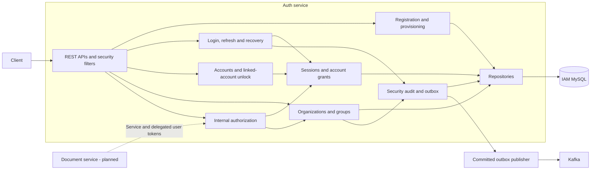
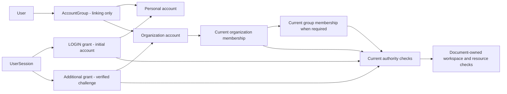
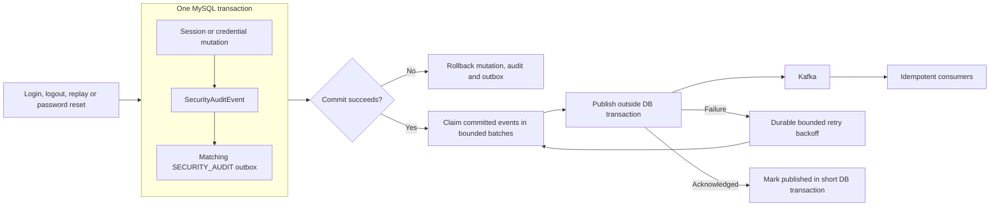

# Auth service architecture

This document describes the implemented IAM/Auth service and the integration contract
for the future Document service. [PROJECT_SPEC.md](../PROJECT_SPEC.md) defines the
domain semantics; [internal authorization](internal-authorization.md) defines the
deployment settings and HTTP contract. Infrastructure and observability are described
in [the platform architecture](platform-architecture.md).

## Capability and ownership boundaries

Auth owns identity, credentials, sessions, account grants, organizations, groups,
security audit and its transactional outbox. Document will own workspaces, document
permissions and content metadata. Cross-service references are UUIDs, without
cross-service database foreign keys or direct access to another service's database.



HTTP controllers validate input and delegate use cases. Security filters establish
authentication; application services enforce current domain authority. MySQL is the
transactional source of truth, with Flyway migrations. Redis rate limits and
authorization projections, and local Caffeine snapshots, are disposable infrastructure.

Source: [security configuration](../src/main/java/com/unidocs/auth/security/config/SecurityConfiguration.java),
[internal authorization service](../src/main/java/com/unidocs/auth/authorization/application/InternalAuthorizationService.java).

## Registration and provisioning

Verification and provisioning are distinct steps. Provisioning is transactional and
retry-safe; verified registrations can retry completion without verifying again.
Pending registrations have no ordinary account, session or document authority.
Only hashes of passwords and verification secrets are persisted.

```mermaid
stateDiagram-v2
    [*] --> PENDING_VERIFICATION: Registration request
    PENDING_VERIFICATION --> VERIFIED: Valid unexpired verification
    PENDING_VERIFICATION --> EXPIRED: Expiry
    VERIFIED --> VERIFIED: Provisioning failure; retry allowed
    VERIFIED --> COMPLETED: Transaction creates User, UserAccount, LoginIdentity and AccountGroup
    COMPLETED --> COMPLETED: Idempotent completion retry
    COMPLETED --> [*]
```



Source: [registration provisioning](../src/main/java/com/unidocs/auth/registration/application/RegistrationProvisioningService.java).

## Login, access tokens and sessions

Access JWTs carry compact identity/session claims (`sub`, `sid`, `iss`, `aud`,
`iat`, `exp`), rather than mutable permission lists. IAM signs asymmetrically and
publishes public keys at `/.well-known/jwks.json`. Services validate signatures,
issuer, audience, expiry and permitted algorithm locally. JWT validation alone
cannot establish current account, organization or document authority.
Here `sub` identifies the login account, and `sid` identifies its umbrella session;
IAM derives the owning user from server-side state when returning account evidence.

```mermaid
sequenceDiagram
    actor User
    participant Auth as Auth API
    participant Protection as Rate limits and login protection
    participant DB as IAM MySQL
    participant Keys as IAM signing keys
    User->>Auth: Login with account credentials
    Auth->>Protection: Apply abuse protections
    Auth->>Auth: Check password hash outside transaction
    Auth->>DB: Begin transaction; lock and recheck identity/version
    Auth->>DB: Create session, LOGIN grant and hashed refresh secret
    Auth->>DB: Insert login audit and security-audit outbox
    Auth->>Keys: Sign access JWT with current kid
    Auth->>DB: Commit
    Auth-->>User: Access JWT and refresh secret
    Note over User,DB: Invalid credentials return generic failure; credential failures are audited
```

Refresh secrets rotate and are persisted as hashes. Proven reuse of a consumed
refresh secret revokes the session; ordinary invalid refresh attempts have a separate
failure audit. Normal access-token HTTP processing is stateless, while MySQL remains
authoritative for sessions, grants, credential versions and revocation.

Source: [authentication service](../src/main/java/com/unidocs/auth/authentication/application/AuthenticationService.java),
[access tokens](../src/main/java/com/unidocs/auth/security/jwt/AccessTokens.java),
[key ring](../src/main/java/com/unidocs/auth/security/jwt/JwtKeyRing.java).

## Linked accounts and current authority

A login creates one umbrella session and automatically unlocks the login account.
Other linked accounts require a successful challenge. Multiple grants can coexist;
there is no global server-side active account. AccountGroup and preferred-account
selection support linking/navigation and confer no permission.



Checks include session and grant status/expiry, credential version, account
availability and applicable organization policy. Organization membership revocation
is a top-level kill switch for descendants. Group membership cannot bypass it.
Resource step-up is an additional factor, not a permission grant.

## Security mutations, audit and asynchronous delivery

For versioned security audit flows, state changes, the audit row and the matching
security-audit outbox payload commit together. Password reset also writes a separate
login-identity lifecycle event. Audit insertion/outbox failure rolls back the mutation.
Diagnostic logs are separate from durable audit and never contain credentials or tokens.



Password reset verifies the recovery proof, replaces the password hash, increments
the credential version and revokes affected authority in one transaction. Outbox
delivery may repeat after a crash or acknowledgement failure; consumers must handle
duplicates and stale versions. No Kafka/Redis call spans the business transaction.

Source: [audit recorder](../src/main/java/com/unidocs/auth/audit/application/LoginAuditRecorder.java),
[password recovery](../src/main/java/com/unidocs/auth/credential/recovery/email/EmailPasswordRecoveryService.java),
[outbox publisher](../src/main/java/com/unidocs/auth/outbox/application/OutboxPublisher.java),
[audit contract](observability/login-audit.md).

## Document-to-IAM trust and authorization

The account, organization and group POST endpoints beneath
`/api/v1/internal/authorization` are implemented and disabled by default. Enabling
them requires explicitly configured service trust. IAM does not issue service tokens:
an external trusted identity provider supplies them. Document integration and that
issuer's deployment are separate from the implemented IAM endpoints.

```mermaid
sequenceDiagram
    actor User
    participant Document as Document service - planned
    participant Issuer as External service identity provider - configure
    participant IAM as Auth internal authorization
    participant DB as IAM MySQL
    User->>Document: User access JWT and resource request
    Document->>IAM: Obtain/cache public JWKS keys
    Document->>Document: Validate user JWT locally
    Document->>Issuer: Obtain short-lived service JWT
    Issuer-->>Document: Signed service identity token
    Document->>IAM: POST account, organization or group check<br/>Authorization: service JWT<br/>X-Delegated-Authorization: user JWT
    opt Service signing keys need retrieval
        IAM->>Issuer: Fetch public keys from configured HTTPS JWKS
        Issuer-->>IAM: Trusted public signing keys
    end
    IAM->>IAM: Verify service issuer/audience, RS256, subject, scope and lifetime
    IAM->>IAM: Independently verify delegated user JWT
    IAM->>DB: Lock session; recheck token expiry and current account/membership authority
    DB-->>IAM: Current evidence; update session/grant activity
    IAM-->>Document: Point-in-time evidence; Cache-Control: no-store
    Document->>Document: Enforce workspace type, membership, status and resource visibility
    Document-->>User: Authorized response or denial
```

Service JWTs require a distinct trusted issuer/audience, allowlisted subject,
`iam.authorization.read` scope, no `sid`, and at most five minutes of lifetime.
Both credential headers require TLS and must never be logged. Invalid/missing
authentication returns 401; authenticated lack of authority returns 403. Dependency
failure cannot produce an allowed response. Arbitrary identity headers confer no authority.

Evidence is immediate: `expiresAt` equals `checkedAt`. Protected operations must
request fresh checks; cached organization snapshots cannot grant access. The broader
Caffeine/Redis authorization design is a future downstream contract requiring
revocation, versions and session/grant expiry handling before decisions can be reused.

| Document workspace | Required IAM evidence | Additional Document check |
| --- | --- | --- |
| OWNER | Current account grant and verified user owner | Compare with workspace owner |
| ORGANIZATION | Current organization authority | Workspace/resource status and visibility |
| GROUP | Organization authority plus effective group membership | Workspace/resource status and visibility |
| RESTRICTED | Current organization authority | Current WorkspaceMember authority and resource visibility |

Document must enforce these checks across listings, search, recent items, favorites
and metadata as well as direct content access. It owns those paths and must not
read IAM MySQL or mutate IAM Redis keys. Production TLS, operator access controls,
retention, recovery and downstream deployment acceptance remain separate deployment work.
