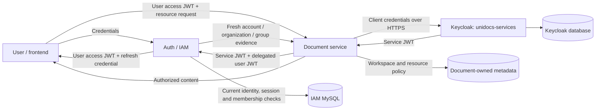
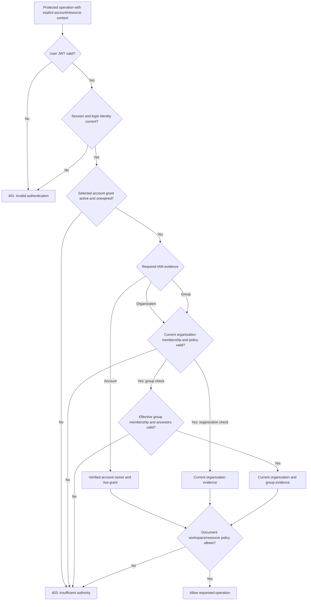
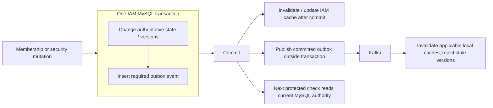

# Keycloak, authentication and authorization

This document explains the Auth implementation and the Document-to-IAM integration contract, based on source and configuration inspected on 13 October 2026. Diagrams use Mermaid and render in a Mermaid-capable Markdown viewer. Runtime availability and end-to-end Document acceptance were not tested for this documentation task.

## 1. Responsibilities and trust boundaries

The system has two token issuers. **Auth authenticates people**, manages their credentials and sessions, and signs user access tokens. **Keycloak authenticates services**, issuing a short-lived client-credentials token that lets Document call IAM's internal authorization endpoints. IAM checks the user's current authority; Document checks access to its own workspaces and resources.



The two database nodes represent separate ownership, even when local deployment uses one shared MySQL server. Document must not read IAM tables. Keycloak does not own platform account grants, organization memberships, group permissions or document visibility. The implemented user login flow does not redirect to Keycloak or use its password grant.

| Concern | Owner |
| --- | --- |
| User registration, password verification, recovery | Auth |
| User JWT signing and public JWKS | Auth |
| Sessions, refresh rotation, linked-account unlock | Auth |
| Service identity and client-credentials JWT signing | Keycloak |
| Current account, organization and group authority | Auth, backed by IAM MySQL |
| Workspace membership, resource visibility and content access | Document |

## 2. How Keycloak is configured

The realm template defines a confidential client, `document-service`, in `unidocs-services`. Service accounts and client authentication are enabled; interactive, implicit and direct password flows are disabled. The client secret comes from the existing ignored configuration, not this document. Admin credentials are distinct from service credentials.

| Setting | Configured contract |
| --- | --- |
| Grant | `client_credentials` |
| Signature | RS256 |
| Subject | `document-service`, set by an explicit mapper |
| Audience | `urn:unidocs:iam-internal` |
| Scope | `iam.authorization.read` |
| Token lifetime | 120 seconds in the realm; IAM accepts at most five minutes |
| User session claim | `sid` must be absent |
| Service refresh token | Disabled; obtain another client-credentials token |
| Advertised issuer | `https://localhost:8443/realms/unidocs-services` |
| Container token URL | `https://keycloak:8443/realms/unidocs-services/protocol/openid-connect/token` |
| Container JWKS URL | `https://keycloak:8443/realms/unidocs-services/protocol/openid-connect/certs` |

Issuer identity and transport hostname intentionally differ: containers reach `keycloak`, while tokens advertise the configured `localhost` issuer. TLS certificate and hostname verification remain required. IAM validates the exact configured issuer rather than replacing it with the transport URL.

```mermaid
sequenceDiagram
    participant D as Document service
    participant K as HTTPS Keycloak
    participant A as Auth internal security filter
    D->>K: POST token endpoint: client_credentials, client ID, secret, scope
    K->>K: Authenticate confidential client
    K-->>D: RS256 service JWT, 120-second lifetime
    Note over D: Reuse service token in memory until near expiry
    D->>A: Internal POST with service bearer token
    opt Public signing key needs retrieval
        A->>K: Fetch configured HTTPS JWKS
        K-->>A: Public signing keys
    end
    A->>A: Validate signature, issuer, audience, subject and timestamps; reject sid
    A->>A: Require iam.authorization.read scope
    Note over A: Passing this filter authenticates the service only
```

The integrated Compose entry point is `../docker-compose.yaml`, project `unidocs`. Current shared definitions place both HTTPS `keycloak` and HTTP `keycloak-dev` behind the `dev` profile on `unidocs_local_network`. HTTPS Keycloak imports generated realm assets and uses MySQL; the separate HTTP development instance exposes localhost port 8082 and is not the trusted service issuer.

Some older passages in `PROJECT_SPEC.md` describe a stopped TLS issuer behind `keycloak-tls` and the former project name. Later specification updates describe the public issuer hostname, and the current shared Compose files define the topology above. This document records that distinction without changing configuration or established security semantics. Enabled profiles alone do not prove either service is running.

## 3. User authentication and session lifecycle

Registration progresses through pending verification, `VERIFIED`, then transactional provisioning to `COMPLETED`. Provisioning creates User, UserAccount, LoginIdentity and AccountGroup idempotently. A pending registration grants no access; registration completion itself does not establish a login session.

For normal password login, Auth applies abuse protection, checks the password hash outside the database transaction, then locks and rechecks current identity, credential version and account availability before creating authority.

```mermaid
sequenceDiagram
    actor U as User / frontend
    participant A as Auth
    participant DB as IAM MySQL
    participant S as Auth signing key
    U->>A: POST /api/v1/auth/login with credentials
    A->>A: Rate limits and login protection; verify password hash
    A->>DB: Begin transaction; lock and recheck identity and version
    alt Credentials and account are valid
        A->>DB: Create UserSession and initial LOGIN account grant
        A->>DB: Store refresh hash; insert audit and matching outbox
        A->>S: Sign compact user JWT with kid
        A->>DB: Commit
        A-->>U: User JWT and refresh credential
    else Authentication fails
        A->>DB: Record applicable failure audit
        A-->>U: Generic authentication failure
    end
    U->>A: POST /api/v1/auth/refresh with refresh credential
    A->>DB: Lock and verify refresh hash and live session state
    alt Valid unused refresh credential
        A->>DB: Consume old credential and store replacement hash
        A-->>U: New user JWT and rotated refresh credential
    else Proven replay of consumed credential
        A->>DB: Commit session, grant and refresh-family revocation
        A-->>U: 401
    end
```

User access tokens are RS256, last five minutes and contain `sub`, `sid`, `iss`, `aud`, `iat`, `exp`. **`sub` identifies the original login account**, while `sid` identifies its umbrella session. IAM derives the human owner from server-side state. Mutable permission lists are excluded, and the user JWT converter supplies no permission authorities.

Auth publishes public keys at `/.well-known/jwks.json`; private keys remain local. Validators check permitted algorithm, signature, issuer, audience, required claims and time validity. Key rotation retains old public keys long enough to verify outstanding tokens.

Normal bearer processing uses `SessionCreationPolicy.STATELESS`. Durable MySQL sessions still govern expiry and revocation: stateless HTTP processing does not eliminate server-side security state. The documented session policy uses a 12-hour absolute deadline and 30-minute grant idle expiry. Refresh cannot revive an expired grant. Logout revokes the matching session family; independent sessions remain separate. Refresh secrets are stored only as hashes. Clients must serialize refresh requests because replay handling has no retry grace window.

## 4. Linked accounts and authorization

Authentication establishes identity; authorization evaluates whether that identity can perform the requested operation **now**. The login account receives its initial `LOGIN` grant automatically. Another linked account requires a valid challenge before it receives a grant. Several grants may remain active together; there is no global server-side `activeAccountId`.



Checks include credential versions, account availability, grant idle/absolute expiry, active organization and membership, restrictions and applicable authentication policy. Group checks also enforce effective membership, validity times, active ancestors and applicable academic enrollment rules. Organization membership revocation is a top-level kill switch for descendants. A group role cannot confer organization administrator authority.

AccountGroup and preferred-account settings support linking and navigation only. A session grant alone does not authorize organization or workspace access. Step-up adds a required authentication factor; it does not create permission.

## 5. End-to-end delegated authorization

Document validates the user's Auth JWT locally, then calls IAM using two independent credentials:

| Header | Identity established |
| --- | --- |
| `Authorization: Bearer <Keycloak service JWT>` | The trusted calling service |
| `X-Delegated-Authorization: Bearer <Auth user JWT>` | The original user's login account and session |

This is delegation of the original user token, not a Keycloak token exchange. IAM independently validates both tokens. Request UUIDs select the account/organization/group to check; they do not prove identity. Arbitrary `X-User-Id` headers have no authority.

```mermaid
sequenceDiagram
    actor U as User
    participant D as Document
    participant K as Keycloak
    participant A as IAM
    participant DB as IAM MySQL
    U->>D: Resource request + Auth user JWT
    D->>D: Validate user JWT using Auth public JWKS
    opt Service token absent or near expiry
        D->>K: HTTPS client-credentials request
        K-->>D: Service JWT
    end
    D->>A: POST internal check + service JWT + original user JWT
    A->>A: Authenticate service and require read scope
    A->>A: Independently validate delegated user JWT
    A->>DB: Lock session and establish current authority
    A->>A: Recheck delegated expiry after acquiring locks
    DB-->>A: Current grant and requested membership evidence
    A->>DB: Touch successful session/grant activity; commit
    A-->>D: Point-in-time evidence, Cache-Control: no-store
    D->>D: Apply Document-owned workspace and resource checks
    D-->>U: Authorized result or denial
```

The internal routes are disabled by default (`INTERNAL_AUTHORIZATION_ENABLED=false`). Enabling them requires distinct service issuer/audience, HTTPS JWKS and allowlisted service subjects. Public-key retrieval and delegated-token decoding occur before the authorization transaction; external network calls do not span database locks.

All endpoints below are POSTs, with the default configurable API base path:

| Endpoint | Request selectors | Result |
| --- | --- | --- |
| `/api/v1/internal/authorization/account` | `accountId` | Live grant, verified owner, session, authentication method and credential version |
| `/api/v1/internal/authorization/organization` | `accountId`, `organizationId` | Current membership ID/role and membership/authorization versions |
| `/api/v1/internal/authorization/group` | `accountId`, `organizationId`, `groupId` | Organization evidence plus effective group membership ID, role and version |

Every response has `expiresAt == checkedAt` and `Cache-Control: no-store`. It is evidence for the current operation, not a reusable permission lease. Document must request fresh checks for protected operations and then enforce its own rules:

| Workspace type | Required IAM check | Additional Document decision |
| --- | --- | --- |
| OWNER | Account | Verified user matches workspace owner |
| ORGANIZATION | Organization | Workspace status and resource visibility |
| GROUP | Group | Workspace status and resource visibility |
| RESTRICTED | Organization | Current WorkspaceMember authority, status and visibility |

The same visibility rules apply to search, listings, recent items, favorites, suggestions, metadata and content downloads. Organization role alone does not authorize document access.

## 6. Caches, revocation and failure behavior

The platform's broader cache design is domain Caffeine → shared IAM Redis → IAM internal endpoint → MySQL, with IAM as the only shared authorization-cache writer. Kafka carries versioned invalidation events; caches are disposable. **The internal endpoints described here perform fresh MySQL checks and do not permit reusable downstream authorization decisions from cached snapshots.** A downstream cache contract must address revocation, stale versions and session/grant expiry before that changes.



For organization revocation, the domain contract also requires relevant grant revocation, durable notification and safe account fallback. Fallback never unlocks an account without its required challenge. Cache propagation does not replace authoritative checks.

Missing, invalid or expired authentication yields 401; valid authentication with insufficient scope/grant/membership yields 403; invalid request fields yield 400. Dependency failure cannot produce an allowed result. Keycloak tokens may be reused until expiry, and public keys may be cached; neither cache makes user permissions reusable. If a new service token or trusted signing key cannot be obtained when required, the operation fails closed.

Both credential headers require protected transport and must never be logged. The documented local Document-to-Auth URL is HTTP on the development bridge; production requires TLS-protected transport. Certificate verification must never be disabled.

## 7. Source references

- [Domain specification](../PROJECT_SPEC.md): authentication/session, internal authorization and local issuer contracts.
- [Keycloak realm template](../docker/keycloak/unidocs-services-realm.json): client, claims, scope and lifespan.
- [HTTPS Keycloak Compose definition](../../docker/compose/keycloak.yml) and [HTTP development definition](../../docker/compose/keycloak-dev.yml): current deployment configuration.
- [User authentication service](../src/main/java/com/unidocs/auth/authentication/application/AuthenticationService.java) and [access-token issuer](../src/main/java/com/unidocs/auth/security/jwt/AccessTokens.java): login, refresh, logout and claims.
- [User security configuration](../src/main/java/com/unidocs/auth/security/config/SecurityConfiguration.java): stateless bearer authentication and application routes.
- [Internal security configuration](../src/main/java/com/unidocs/auth/security/config/InternalAuthorizationSecurityConfiguration.java) and [service-token validator](../src/main/java/com/unidocs/auth/security/config/InternalServiceTokenValidator.java): separate service trust and scope enforcement.
- [Internal authorization service](../src/main/java/com/unidocs/auth/authorization/application/InternalAuthorizationService.java) and [controller](../src/main/java/com/unidocs/auth/authorization/api/InternalAuthorizationController.java): delegated-token validation, fresh evidence and no-store responses.
- [Internal authorization contract](internal-authorization.md) and [Document handoff](document-keycloak-handoff.md): integration settings and acceptance requirements.
