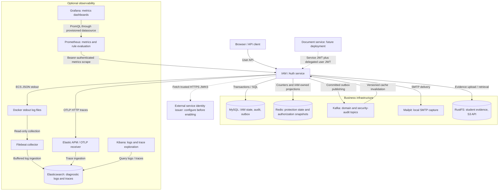
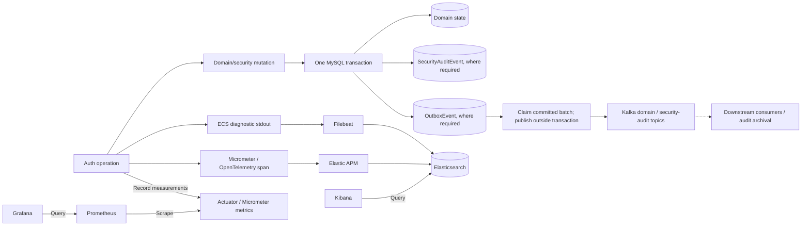
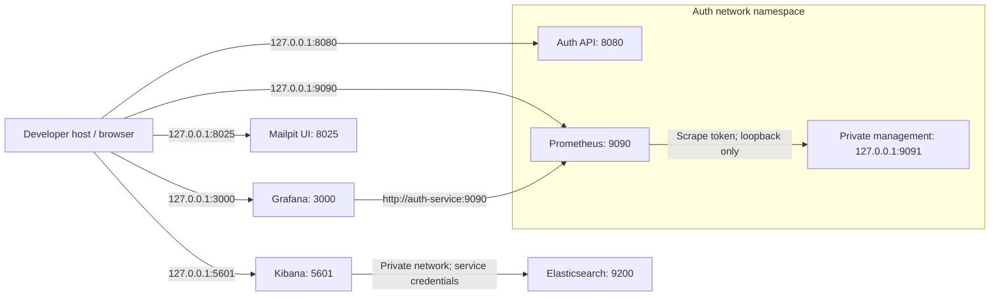
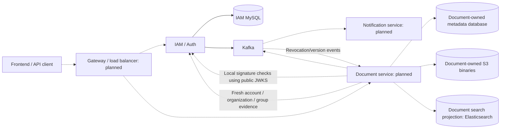

# Auth platform and infrastructure architecture

This guide shows the architecture configured in this repository. Optional Compose
the unified Compose file defines telemetry and dashboards; a diagram connection does not imply that
the corresponding container is currently running. See [Auth internals](auth-architecture.md)
for identity flows and [internal authorization](internal-authorization.md) for the
Document integration contract. [PROJECT_SPEC.md](../PROJECT_SPEC.md) owns platform semantics.

Solid arrows show implemented/configured connections. Dashed arrows identify future
services or deployment integrations. Arrow labels distinguish writes/exports from
queries and scrapes.

## High-level service map

MySQL is the authoritative IAM store. Redis/Caffeine are disposable; Kafka moves
committed events. Elasticsearch stores diagnostic/search projections and does not
authorize users. Grafana and Kibana are separate viewing tools: Grafana reads
Prometheus metrics; Kibana reads Elastic logs and traces. Auth does not send
diagnostic logs directly to Elasticsearch.

## What each connection does

| Component | Auth relationship | Ownership and durability |
| --- | --- | --- |
| MySQL | JPA/JDBC transactions; Flyway migrations; sessions, grants, credentials, memberships, audit and outbox | IAM source of truth; no downstream direct database access |
| Redis | Rate limiting/login protection and IAM-written organization snapshots/version floors | Protection counters and disposable projections; snapshot outages can fall back to MySQL, while protection behavior follows its fail-closed policy |
| Caffeine | Bounded local organization snapshots/version floors inside each JVM | Starts empty; a cached snapshot cannot replace fresh authorization guards |
| Kafka | Outbox publishes domain/security events; IAM listener invalidates local authorization state | Asynchronous propagation; duplicate/stale events require version handling |
| Mailpit | Local registration, invitation and account-notice SMTP capture | Development delivery target; production supplies its mail provider |
| RustFS | S3-compatible student evidence storage adapter | Evidence binaries, separate from MySQL metadata; Document binaries belong to Document-owned S3 storage |
| Filebeat | Reads Docker stdout files, selects Auth ECS events, buffers delivery | External collector with persistent registry/disk queue; not the durable audit ledger |
| Elastic APM | Receives authenticated OTLP trace exports and writes trace data to Elastic | Optional telemetry; sampling does not replace audit history |
| Elasticsearch | Receives logs from Filebeat and traces from APM | Current use is observability; document search indexing is a future Document slice |
| Kibana | Queries Elasticsearch and provides log/trace exploration | UI configuration; no authority over auth state |
| Prometheus | Scrapes private Actuator metrics and evaluates rules | Local seven-day/512 MB configured metric retention; alert delivery is a separate deployment concern |
| Grafana | Server-side Prometheus datasource and provisioned Auth dashboard | Dashboard state in its volume; anonymous access and local unified alerting are disabled |

## Logs, traces, metrics and durable audit

MySQL audit rows are durable facts; the matching audit envelope can also be queued
transactionally for Kafka. Diagnostic logs, sampled traces and metrics serve
investigation/operations. Kafka delivery retries through the outbox without holding
database transactions across network calls. Audit archival consumers shown here
are a downstream integration, not a deployed archive in this repository.

## Local network and dashboard topology

The metrics service uses `network_mode: service:auth-service` for Prometheus.
Consequently `127.0.0.1:9091` is reachable by Prometheus in that shared namespace,
and Grafana reaches Prometheus through `auth-service:9090`. Management port 9091
has no host publication. Grafana has its own admin credential and never receives
the Auth scrape token.

MySQL 3306, Redis 6379, Kafka 9092, RustFS 9000/9001, SMTP 1025, Elasticsearch 9200
and APM 8200 are internal Compose endpoints in these files. Host ports shown above
are default values and can be overridden. Local Elastic HTTP and Kafka PLAINTEXT
are development settings; production transport security remains a deployment slice.

## Platform service ownership and future integration

IAM owns identity, session grants and organization/group authority. Document owns
workspace permissions, directories, metadata and resource visibility. The internal
authorization routes are implemented but disabled until separate service-token
trust is configured. Document, gateway, notification delivery service, document
indexing and downstream authorization caches shown here are future integrations.
Each service owns its data: no cross-service database reads or foreign keys.

## Availability boundaries

Elasticsearch, Filebeat, APM, Kibana, Prometheus and Grafana are absent from Auth
Compose `depends_on` and application readiness dependencies. Their outage can lose
or delay observability data without becoming an authorization grant or a login
dependency. Filebeat buffering is bounded; it cannot promise unlimited outage recovery.

Current Compose startup waits for MySQL, Redis, Kafka, Mailpit and evidence storage,
plus bootstrap jobs. Current readiness includes database, Redis and Kafka health.
That deployment gating is distinct from per-operation behavior: authorization
snapshot cache failures can fall back to fresh MySQL, and committed outbox records
can await Kafka recovery. Internal authorization fails closed if current SQL
authority cannot be established. Live collector recovery and production
TLS/RBAC/retention/backup/alert delivery remain the previously deferred work.

## Configuration sources

- [Workspace Compose services](../../docker-compose.yaml)
- [Shared Elastic telemetry services](../../docker-compose.yaml), [Filebeat](../docker/observability/filebeat.yml), [APM](../docker/observability/apm-server.yml)
- [Shared metrics services](../../docker-compose.yaml), [Prometheus scrape configuration](../docker/metrics/prometheus.yml), [private management listener](../src/main/resources/application-metrics.properties)
- [Shared Grafana service](../../docker/compose/grafana.yml), [datasource provisioning](../docker/metrics/grafana/provisioning/datasources/prometheus.yaml)
- [Observability implementation record](UNIDOCS_AUTH_OBSERVABILITY.md), [security audit contract](observability/login-audit.md)
